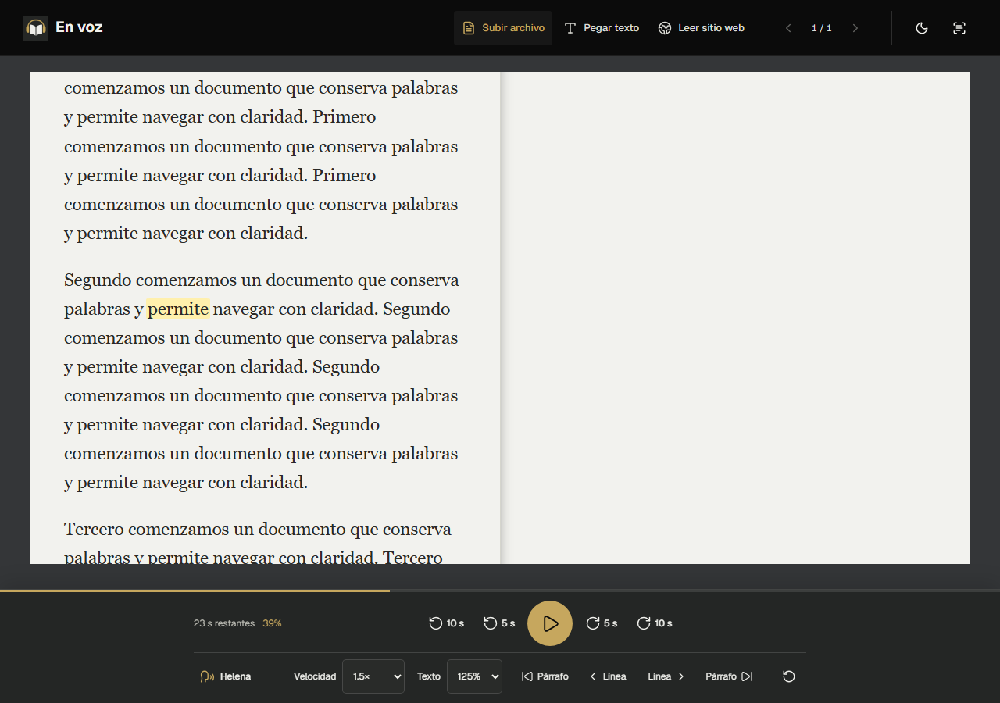
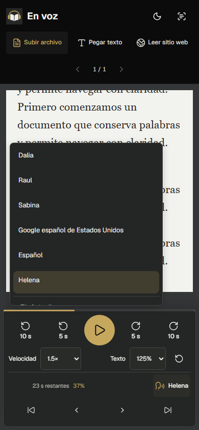
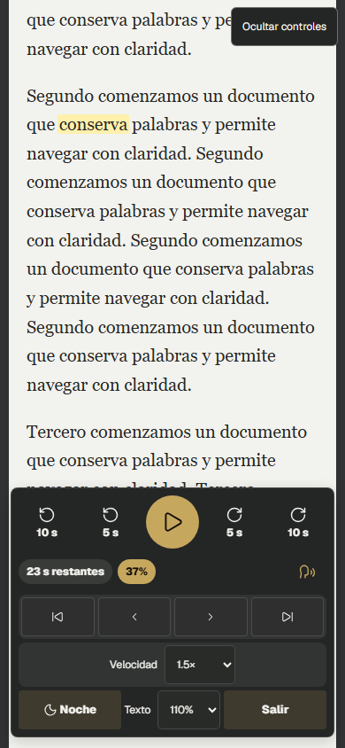

# Voces del dispositivo y controles

Comprobación del 10 de octubre de 2026 UTC, 9 de octubre en México.

Las capturas proceden de perfiles aislados de Chromium, con texto público de prueba y un catálogo simulado. Sirven para verificar los controles y la disposición visual; no prueban que Dalia, Sabina o cualquier otra voz esté instalada en el equipo del usuario ni evalúan su calidad audible.

Se comprobaron 1280 × 900, 914 × 677, 390 × 844 y 320 × 740 px. Las pruebas verificaron detección tardía, actualización manual y por evento, filtro de español, orden de México, teclado, selección, pausa/reanudación, velocidad durante pausa, saltos sin diálogos, tamaño del texto, autoguardado y recuperación tras recarga. No hubo solicitudes de TTS remoto, modelos de voz ni errores de CSP.

También se comprobó que un catálogo únicamente inglés no inicie audio y que cancelar una búsqueda pendiente impida una reproducción tardía. Las etiquetas y selectores quedan centrados y no se solapan con los demás controles. Pantalla completa utiliza el mismo selector compacto de velocidad.

El análisis estático, TypeScript y las 267 pruebas unitarias pasaron. Las comprobaciones locales de interfaz se ejecutaron con Next en desarrollo. El entorno Windows impidió crear junctions/carpetas generadas en la compilación; la compilación completa y la prueba offline se verifican en el flujo de GitHub Actions y el despliegue de Vercel, sin desactivar esas comprobaciones.

## Escritorio

## Móvil

